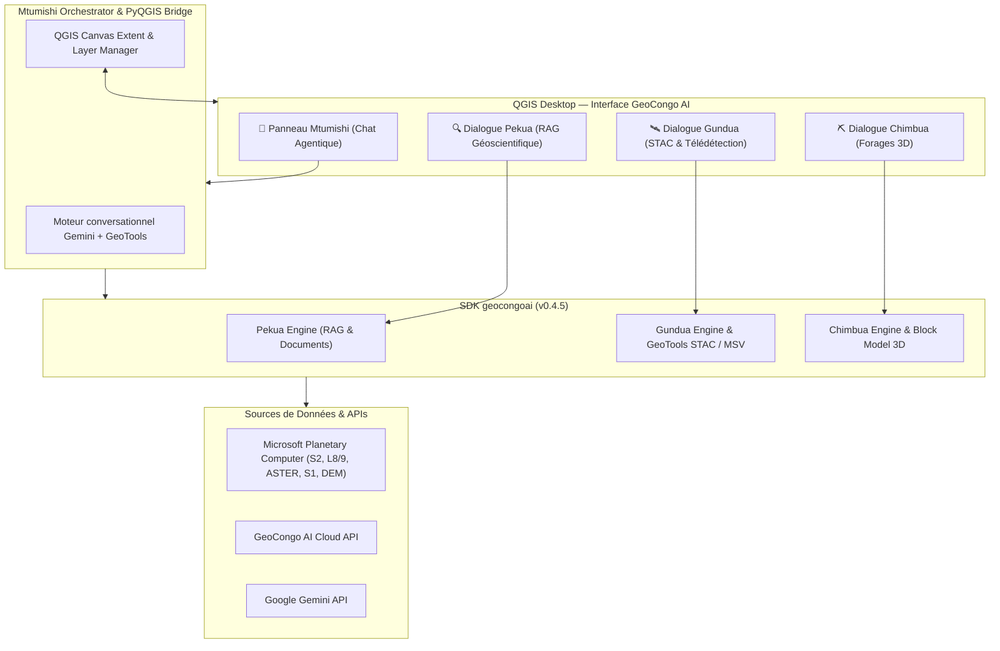

# 🌍 GeoCongo AI pour QGIS Desktop

[](https://qgis.org)
[](https://python.org)
[](metadata.txt)
[](https://pypi.org/project/geocongoai/)
[](LICENSE)

Extension QGIS officielle propulsée par le SDK Python **`geocongoai` v0.4.5**. Elle transforme **QGIS Desktop** en une station de travail géoscientifique de pointe, intégrant un **assistant IA agentique en langage naturel (Mtumishi)**, l'accès direct aux catalogues satellitaires ouverts via **Microsoft Planetary Computer STAC**, la télédétection géobotanique avancée (**Metal-Stressed Vegetation — MSV**), le RAG géologique (**Pekua Engine**) et la modélisation 3D / géostatistique de forages (**Chimbua Engine**).

---

## 🎯 1. Vue d'Ensemble des 4 Moteurs Intégrés



### 🤖 1. Mtumishi — L'Assistant Agentique QGIS
* Dialogue interactif en langage naturel dans un dockwidget dédié.
* Streaming fluide des réponses en Markdown riche avec journalisation détaillée des étapes agentiques (`status`, `thought`, `tool_call`, `tool_result`).
* Pilotage direct de QGIS Desktop via des **GeoTools** :
  * Recherche et extraction satellitaire STAC (`stac_search_scenes`, `stac_calc_indices`, `stac_calc_msv`).
  * Manipulation de couches (chargement, zoom, suppression, identification).
  * Coloration et symbologie automatique des rasters géoscientifiques.
  * Préparation automatisée de jeux de forages (`assay`, `collar`, `survey`).
  * Exécution de pipelines 3D Chimbua et estimation de ressources géostatistiques.
  * Exécution sécurisée de scripts PyQGIS à la volée.

### 🛰️ 2. Gundua & GeoTools STAC — Télédétection Satellitaire & Géobotanique MSV
* **Connexion native à Microsoft Planetary Computer STAC** (sans clé payante requise) pour Sentinel-2 L2A, Landsat 8/9, Sentinel-1 RTC (Radar SAR), ASTER L1T et Copernicus DEM GLO-30.
* **15+ indices spectraux supportés** :
  * **Exploration Minière & Altérations** : `IRON_OXIDE` ($B04/B02$), `CLAY_OH` ($B11/B12$), `FERROUS` ($B12/B8A$).
  * **Altération Hydrothermale Fine (ASTER L1T - Formules Rowan/Ninomiya)** : `ALUNITE`, `KAOLINITE`, `SERICITE_MUSCOVITE`, `CARBONATE_DOLOMITE`, `CHLORITE_EPIDOTE`, `QUARTZ_SILICA`, `FERRIC_IRON_ASTER`, `FERROUS_IRON_ASTER`, `GOSSAN`.
  * **Végétation & Humidité** : `NDVI`, `EVI`, `SAVI`, `NDRE` (Red-Edge 1), `NDMI`.
  * **Eau, Feux & Risques Naturels** : `NDWI`, `MNDWI`, `AWEI`, `NBR`, masque d'inondation SAR/optique, masque de sévérité d'incendie $dNBR$.
* **🌱 GeoTool MSV (Metal-Stressed Vegetation)** :
  * Analyse multitemporelle pour la détection géobotanique des minéralisations sous-jacentes (Cuivre, Cobalt, Or, Nickel) dans les forêts et savanes d'Afrique Centrale (ex. Copperbelt Lualaba / Haut-Katanga).
  * Calcul de persistance temporelle, anomalie Z-Score et indice composite `MSV_COMPOSITE`.
  * Extraction et vectorisation des cibles candidates géoréférencées (`MSV_TARGETS`) avec score de confiance, centroïde et surface en $\text{m}^2$.

### 🔍 3. Pekua — RAG & Recherche Documentaire Géologique
* Recherche sémantique avancée sur la base documentaire GeoCongo AI (rapports techniques d'exploration, thèses universitaires, notices de cartes géologiques).
* Filtrage thématique par substance minérale, domaine géoscientifique ou province de RDC.
* Synthèse intelligente avec citation précise des sources.

### ⛏️ 4. Chimbua — Forages 3D & Estimation de Ressources
* Détection automatique et préparation des tables de forages (`collar`, `survey`, `assay`).
* Clustering spatial 3D par algorithme **DBSCAN** sur les teneurs minéralisées.
* Modélisation de blocs 3D avec interpolation par **Inverse Distance Weighting (IDW)** ou **Krigeage Ordinaire (Ordinary Kriging)**.
* Classification des blocs selon les standards de ressources (`Mesuré`, `Indiqué`, `Inféré`, `Non Économique`).
* Exportation de rapports exécutifs complets en `HTML` et `JSON`, et visualisations 3D interactives prêtes pour le navigateur.

---

## 📦 2. Installation & Déploiement

### Étape 1 : Installer le Plugin dans QGIS
Placez ce dossier dans le répertoire des plugins Python de votre profil QGIS :

* **Linux (Ubuntu/Debian)** :
  ```bash
  ~/.local/share/QGIS/QGIS3/profiles/default/python/plugins/geocongoai_qgis
  ```
* **Windows** :
  ```text
  %APPDATA%\QGIS\QGIS3\profiles\default\python\plugins\geocongoai_qgis
  ```
* **macOS** :
  ```text
  ~/Library/Application Support/QGIS/QGIS3/profiles/default/python/plugins/geocongoai_qgis
  ```

### Étape 2 : Installer le SDK dans l'environnement Python de QGIS

> [!IMPORTANT]
> Les packages doivent être installés dans l'interpréteur Python exécuté par QGIS.

#### Option recommandée (via Terminal Linux) :
```bash
# Installation du SDK v0.4.5 avec les modules agentiques et STAC
python3 -m pip install --user --upgrade "geocongoai[agent,stac]==0.4.5"
```

*Si vous développez localement avec le code source du SDK :*
```bash
python3 -m pip install --user --upgrade -e "/chemin/vers/geocongoai[agent,stac]"
```

#### Option alternative (directement dans la Console Python de QGIS) :
Ouvrez le menu **Extensions > Console Python** (`Ctrl + Alt + P`) et exécutez :
```python
import sys, subprocess
subprocess.run([sys.executable, "-m", "pip", "install", "--upgrade", "--user", "geocongoai[agent,stac]==0.4.5"])
```

---

## ⚙️ 3. Configuration & Diagnostic

1. Dans QGIS, allez dans le menu **GeoCongo AI > ⚙️ Paramètres API & Serveur**.
2. Renseignez :
   * **Clé API Google Gemini** : Nécessaire pour activer Mtumishi en mode agentique conversationnel avancé.
   * **Clé API GeoCongo AI** : Pour interroger les moteurs Pekua et Gundua Cloud.
   * **Modèle Gemini** : Sélection du modèle (par exemple `gemini-2.5-flash` ou `gemini-1.5-pro`).
3. **Diagnostic automatique** :
   * Cliquez sur **🔎 Diagnostiquer Mtumishi** pour vérifier la compatibilité des librairies (`protobuf`, `google-genai`, `geocongoai`).
   * Cliquez sur **🩹 Réparer Mtumishi** pour réinstaller ou mettre à jour automatiquement les dépendances manquantes.

---

## 💬 4. Exemples de Commandes pour Mtumishi

Ouvrez l'onglet **🤖 Mtumishi** dans le panneau latéral et interagissez directement :

### Télédétection & STAC
> *"Recherche les scènes Sentinel-2 récentes sur mon emprise avec moins de 15% de nuages."*  
> *"Calcule les indices d'altération hydrothermale (CLAY_OH et IRON_OXIDE) sur la zone affichée."*  
> *"Applique le workflow ASTER L1T pour cartographier l'alunite et la kaolinite."*  
> *"Lance l'analyse géobotanique MSV pour détecter le stress métallique sur la végétation entre mai 2025 et mai 2026."*

### Forages & Géologie 3D
> *"Prépare les couches assay_BABBITT, collar_BABBITT et survey_BABBITT pour Chimbua."*  
> *"Lance un pipeline Chimbua 3D sur assay_BABBITT avec un cutoff de 0.5% Cu."*  
> *"Estime les ressources de cuivre par IDW avec une taille de bloc 25x25x10 et exporte le rapport."*

### Cartographie & SIG QGIS
> *"Zoome sur l'emprise de la couche raster greenfield."*  
> *"Applique une rampe de couleur Spectral en 7 classes sur le raster d'altération."*  
> *"Exécute un script PyQGIS pour exporter la carte courante en GeoTIFF."*

---

## 🗂️ 5. Structure du Code

```text
geocongoai_qgis/
├── __init__.py                 # Initialisation du module QGIS
├── geocongoai_qgis.py          # Point d'entrée de l'extension, menus et barre d'outils
├── metadata.txt                # Métadonnées officielles du dépôt de plugins QGIS (v0.4.5)
├── icon.png                    # Logo officiel de l'extension
├── resources/                  # Ressources graphiques additionnelles
├── gui/                        # Composants d'interface graphique (PyQt5)
│   ├── main_dock.py            # Panneau latéral à onglets avec Chat Mtumishi enrichi
│   ├── gundua_dialog.py        # Dialogue Greenfield & sélecteur STAC (MSV, ASTER, etc.)
│   ├── pekua_dialog.py         # Dialogue de recherche documentaire géologique RAG
│   ├── drillhole_dialog.py     # Dialogue d'analyse et clustering 3D Chimbua
│   ├── settings_dialog.py      # Configuration des clés, serveur et outils de diagnostic
│   └── components/
│       └── area_selector.py    # Sélecteur d'emprise BBOX dynamique synchronisé avec le canevas
├── tasks/
│   └── gundua_task.py          # Tâches d'arrière-plan QgsTask non bloquantes
├── utils/
│   ├── mtumishi_orchestrator.py # Cœur agentique, enregistrement des GeoTools & PyQGIS Bridge
│   ├── drillhole_adapter.py    # Détection et normalisation des tables d'intervalles de forages
│   ├── chimbua_visualization.py # Rendu 3D HTML, symbologie des clusters et des teneurs
│   ├── crs_utils.py            # Transformations géométriques et validation des BBOX WGS84
│   └── supabase_bridge.py      # Pont HTTP sécurisé vers l'API Cloud GeoCongo
└── LICENSE                     # Licence MIT
```

---

## 📋 6. Changelog Récent

### `v0.4.5` (25 Octobre 2026)
* **GeoTools STAC Planetary Computer** : intégration native de `stac_search_scenes`, `stac_calc_indices` et `stac_calc_msv`.
* **Altération Hydrothermale ASTER L1T** : support des 9 indices Rowan/Ninomiya (Alunite, Kaolinite, Séricite, Carbonate, Chlorite, Quartz, etc.).
* **Télédétection Géobotanique MSV** : détection multitemporelle du stress végétal métallique et vectorisation automatique des cibles minéralisées candidates.
* **Sécurisation du Chat Mtumishi** : élimination des interceptions de faux-positifs par mots-clés au profit du raisonnement sémantique du modèle Gemini.
* **Repli automatique sur l'emprise QGIS** : extraction automatique des coordonnées WGS84 du canevas si l'emprise n'est pas spécifiée dans le prompt.

### `v0.4.4` (05 Octobre 2026)
* Conformité complète avec les scans de sécurité du dépôt officiel QGIS (Bandit, Flake8, detect-secrets).
* Sécurisation des fichiers temporaires et des timeouts réseau.

### `v0.4.3` (Septembre 2026)
* Refonte complète du panneau latéral avec interface à onglets.
* Intégration de l'orchestrateur Mtumishi avec streaming temps réel et trace des appels d'outils.

---

## 📄 7. Licence

Ce projet est sous licence [MIT](LICENSE). Développé par l'équipe **GeoCongo AI**.  
Pour toute question ou assistance technique : `contact@geocongoai.com`.
